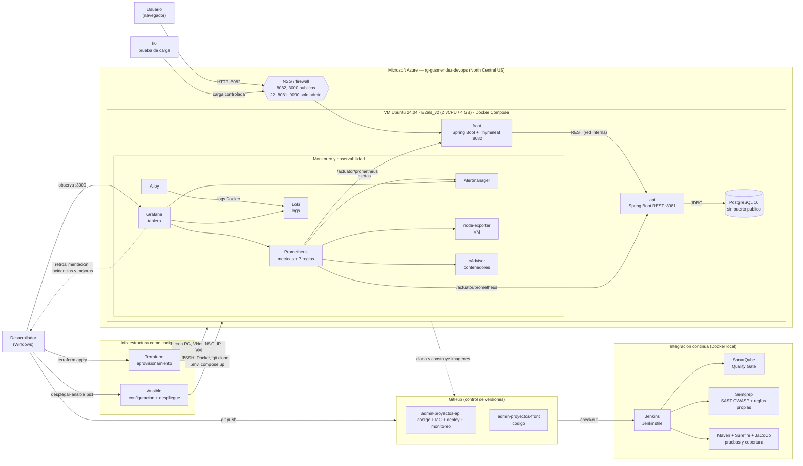

# Arquitectura DevOps — admin-proyectos

## 1. Diagrama de componentes y flujo

## 2. Flujo de extremo a extremo

1. **Codigo y versionado.** El desarrollador sube cambios a GitHub (dos repos: API y front). Todo lo de infraestructura, despliegue y monitoreo vive en el repo de la API.
2. **Integracion continua (Jenkins).** Cada ejecucion del `Jenkinsfile` hace checkout, compila con Maven, ejecuta las pruebas (Surefire), mide cobertura (JaCoCo, regla de 100% de metodos), analiza calidad en SonarQube con Quality Gate y ejecuta SAST con Semgrep (OWASP Top 10, `p/java`, `p/secrets` y reglas propias).
3. **Aprovisionamiento (Terraform).** `terraform plan/apply` crea en Azure el grupo de recursos, la red, el firewall, la IP publica con DNS y la VM. Al final genera el inventario de Ansible con la IP real.
4. **Configuracion y despliegue (Ansible).** Por SSH instala Docker, crea swap, clona el repo, escribe el `.env` (permisos 600, contrasenas conservadas entre despliegues) y ejecuta `docker compose up --build`. Termina verificando la salud del front, Grafana, Prometheus y todos los objetivos de monitoreo.
5. **Ejecucion.** En la VM corren 10 contenedores: la aplicacion (PostgreSQL, API y front) y el monitoreo.
6. **Monitoreo.** Prometheus recolecta metricas de la aplicacion (Actuator/Micrometer), de la VM (node-exporter) y de cada contenedor (cAdvisor); evalua 7 reglas de alerta y las envia a Alertmanager. Alloy recolecta los logs de Docker y los guarda en Loki. Grafana muestra todo en un tablero.
7. **Retroalimentacion.** Las alertas, el tablero y las pruebas de carga (k6) generan hallazgos que se registran en la bitacora de incidencias y vuelven al paso 1 como cambios de codigo o de infraestructura.

## 3. Conexiones y puertos

| Origen | Destino | Puerto | Exposicion |
|---|---|---|---|
| Usuario | front | 8082/tcp | Internet |
| Administrador | Grafana | 3000/tcp | Internet (con usuario y contrasena) |
| Administrador | SSH, API, Prometheus | 22, 8081, 9090/tcp | Solo IP del administrador (NSG) |
| front | api | 8081 | Red interna de Docker |
| api | PostgreSQL | 5432 | Red interna de Docker (sin puerto publicado) |
| Prometheus | api, front, node-exporter, cAdvisor | 8081, 8082, 9100, 8080 | Red interna |
| Alloy | Loki | 3100 | Red interna |
| Ansible | VM | 22 | Llave SSH ed25519 |

## 4. Justificacion de decisiones

| Decision | Alternativas | Justificacion |
|---|---|---|
| **Azure** (VM IaaS) | AWS, GCP, Oracle, PaaS (App Service) | Suscripcion Azure for Students disponible sin tarjeta. Una VM da control total para instalar el monitoreo y demostrar IaC completo (aprovisionamiento + configuracion), cosa que un PaaS oculta. La politica de la suscripcion solo permite 5 regiones; se eligio North Central US por cercania a Mexico. |
| **Terraform** para aprovisionar | ARM/Bicep, CLI | Declarativo, multi-nube, con `plan` previo y estado: muestra exactamente que se crea/cambia/destruye y es reproducible. |
| **Ansible** para configurar | cloud-init, scripts bash | Idempotente, sin agente (solo SSH) y legible. Terraform y Ansible tienen alcances distintos: uno crea la maquina, el otro define su estado interno. |
| **Docker Compose** en la VM | Kubernetes (AKS) | El mismo stack se prueba en local y en la nube. Para 3 servicios y 1 VM, Kubernetes agregaria complejidad y costo sin beneficio para el objetivo del curso. |
| **B2als_v2** (2 vCPU / 4 GB) | B1s, B2s | La opcion mas economica que soporta 2 JVM + PostgreSQL + monitoreo; se agrego swap de 2 GB como margen. |
| **Prometheus + Grafana + Loki** | Azure Monitor | Herramientas abiertas y portables, configuradas como codigo y versionadas en el repo. |
| **k6** | JMeter | Escenario como codigo (JavaScript), umbrales de aceptacion automaticos y reporte HTML. |

## 5. Seguridad

- Acceso a la VM solo con llave SSH; contrasenas deshabilitadas.
- Firewall con minimo privilegio: solo 8082 y 3000 abiertos al publico.
- Contenedores de la aplicacion con usuario sin privilegios y limites de memoria.
- Sin secretos en el repositorio: `.env`, `terraform.tfvars`, `*.tfstate` e inventario estan en `.gitignore`. Las contrasenas se generan aleatoriamente en la VM (permisos 600).
- Contrasenas de usuarios cifradas con BCrypt; Actuator solo expone `health`, `info` y `prometheus`.
- SAST (Semgrep) y analisis de calidad (SonarQube) en el pipeline.
